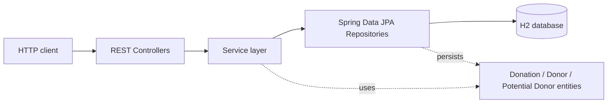

# Donation Management System | Java Spring Boot REST API

[](https://www.java.com/)
[](https://spring.io/projects/spring-boot)
[](https://maven.apache.org/)
[](https://www.h2database.com/)

A backend REST API for recording donations and maintaining donor and prospective-donor records. The application is built with Spring Boot and organized into controller, service, and repository layers, with persistence provided by Spring Data JPA and an H2 database.

## What the project contains

- JPA entities for donations, donors, and prospective donors.
- REST controllers for donation and donor-related operations.
- Service classes that implement the current donation and donor workflows.
- Spring Data JPA repositories backed by H2.
- A Spring Boot application-context test.

This repository contains a backend API; it does not include a frontend, authentication, or authorization.

## Technology

| Technology | Use in this project |
|---|---|
| Java 26 | Application language and configured Java version |
| Spring Boot 4.1.0 | Application framework |
| Spring Web MVC | REST controllers and HTTP endpoints |
| Spring Data JPA | Repository and persistence layer |
| H2 | Database, configured as a file in the user's home directory |
| Maven Wrapper | Build and run commands |
| Spring Boot Test | Application-context test dependency |

## Architecture



The controllers expose HTTP routes and delegate to services. Services perform the application operations and use Spring Data JPA repositories to access the entities stored in H2.

## Implemented API

The routes below are declared by the current controllers. The notes describe their current code paths; they do not imply input validation or behavior beyond what is implemented.

| Method | Route | Request body | Implemented behavior |
|---|---|---|---|
| `POST` | `/insertDonation` | `Donation` JSON | For a non-zero `sum`, creates a donor containing the donation's phone if no donor with that ID exists, saves the donation, removes a prospective donor with that ID if present, and returns `"ADD"`. For zero `sum`, returns `"not money"` without saving. |
| `GET` | `/GetSumDonation` | None | Iterates through the donation records and adds their `numPayment` values. It does not total the `sum` field. |
| `GET` | `/sortdate` | None | Returns donation records sorted by `date` descending. |
| `GET` | `/sumdonor` | A JSON string containing a phone number | Attempts to filter donation records by phone and sum their `sum` values, returning `-1` if no records match. The current service compares phone strings by reference (`==`), so matching by string content is not reliable. |
| `POST` | `/addDonor` | `Donor` JSON | Saves the supplied donor through the donor repository. The controller does not define a response body. |
| `GET` | `/sumdonor1` | `Donor` JSON | Passes the donor's phone to the same phone-based donation-sum operation as `/sumdonor`, including its reference-based string comparison. |
| `GET` | `/AllDonation` | `Donor` JSON | Attempts to filter donation records by the donor's phone and return the matching list. The current service compares phone strings by reference (`==`), so matching by string content is not reliable. |
| `GET` | `/getFirst` | None | Returns the phone number of the first item in the repository result, or `"000"` if the result is empty. No ordering is specified. |
| `POST` | `/add` | `PotantialDonor` JSON | Saves the supplied prospective donor. The controller does not define a response body. |

The `GET` routes `/sumdonor`, `/sumdonor1`, and `/AllDonation` accept request bodies in the current controller definitions. Support for GET request bodies can vary between clients and intermediaries.

## Request JSON examples

These examples use fictional values and the property names declared by the Java entity classes. The `date` value is shown as an ISO-8601 UTC timestamp.

### Donation

Used by `POST /insertDonation`.

```json
{
  "idDonation": "donation-001",
  "numPayment": 1,
  "option": 0,
  "date": "2026-01-15T10:30:00.000+00:00",
  "phone": "555-0101",
  "sum": 50.0
}
```

### Donor

Used by `POST /addDonor` and as the request-body shape for `GET /sumdonor1` and `GET /AllDonation`.

```json
{
  "phone": "555-0101",
  "name": "Alex Example",
  "address": "123 Example Street",
  "mail": "alex@example.com"
}
```

### Prospective donor

Used by `POST /add`.

```json
{
  "phone": "555-0102",
  "name": "Jordan Example"
}
```

### Phone number lookup

`GET /sumdonor` takes a JSON string as its body:

```json
"555-0101"
```

## Run locally

### Prerequisites

- JDK 26

### Start the application

From the project directory, run:

```powershell
.\mvnw.cmd spring-boot:run
```

The application uses Spring Boot's default HTTP port (`8080`) and the configured file-based H2 database. The H2 console is enabled at `/h2console/`.

### Run the tests

```powershell
.\mvnw.cmd test
```

The test source contains an application-context-load test.

## Project layout

```text
src/
├── main/
│   ├── java/com/example/project/
│   │   ├── Controllers/
│   │   ├── Models/
│   │   ├── Repositories/
│   │   ├── Services/
│   │   └── ProjectApplication.java
│   └── resources/
│       └── application.properties
└── test/
    └── java/com/example/project/
        └── ProjectApplicationTests.java
```
